# MakerMonitor

**Your MakerWorld stats, live on a screen on your desk.**

MakerMonitor watches your [MakerWorld](https://makerworld.com) creator account and shows downloads, prints, boosts, likes, collects, ratings, comments, followers and points as they happen. A small poller on your home network does the checking; the numbers land on a dedicated color display, in a web dashboard, and in the chat or push service you already use.

[](LICENSE)
[](https://wolfrage76.github.io/MakerMonitor/)

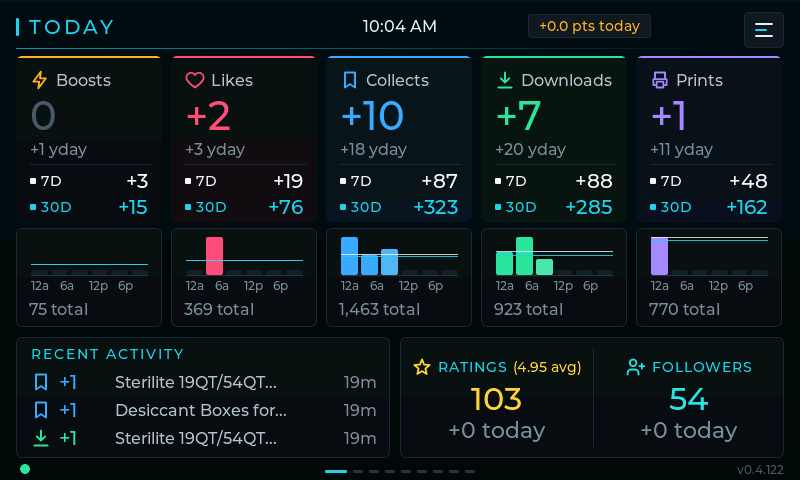

**Anyone can use it**, no hardware needed: the web dashboard works on any phone or computer on your network, and notifications reach Discord, Telegram, Pushover, ntfy, Home Assistant and more.
**The panels are what set it apart**: a glanceable display that shows a banner (and on the 7″, chimes) when someone downloads or prints your model, flashed straight from your browser.

- [Desk panels](#desk-panels)
- [Web dashboard](#web-dashboard)
- [Notifications](#notifications)
- [How it works](#how-it-works)
- [Quick setup](#quick-setup)
- [Supported boards](#supported-boards)
- [Configuration](#configuration) · [Privacy](#privacy-and-being-polite-to-makerworld) · [FAQ](#faq-and-troubleshooting)

---

## Desk panels

An always-on display beside your printer or monitor, so you never need to keep a MakerWorld tab open. Every supported board, from a 2″ cube to a 7″ touchscreen, gets the same pages; the layout adapts to the glass.

The same Today page as the 7″ above, on smaller boards:

| 3.16″ (820×320), rotary knob | 2″ (320×240), touch |
|---|---|
| 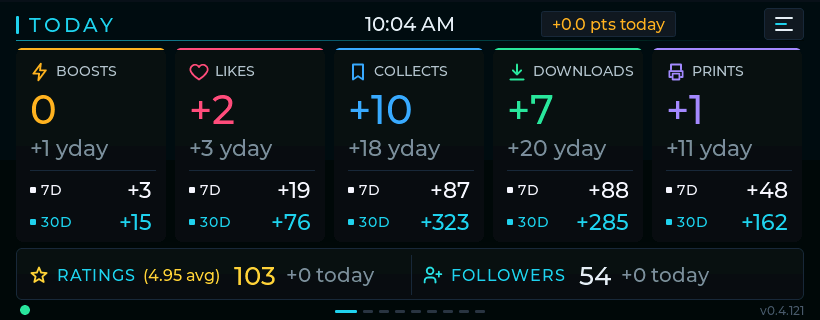 | 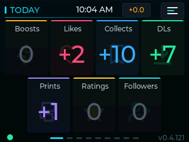 |

- **Live as it happens**: a banner (and on the 7″, a chime) for each download, print, boost, like, collect, rating, comment and new follower.
- **Swipeable pages**: Today with 7 and 30-day context, a live feed, top models with per-model detail, trends, points, reach, comments, best times, and creator pages (conversion, launches, followers, comments to answer).
- **Made to live on a desk**: quiet hours with a night mode, brightness, a Settings page on the screen itself, on-screen Wi-Fi setup, and a small web console at `http://makermonitor.local/`.
- **Easy to install and keep current**: flash it from Chrome or Edge with the [web flasher](https://wolfrage76.github.io/MakerMonitor/), no toolchain needed; later updates arrive over Wi-Fi.
- **Several at once**: put one on your desk and one by the printer. An e-paper panel (Elecrow 2.13″, low power) is supported too.

More pages from the 7″:

| | |
|---|---|
| 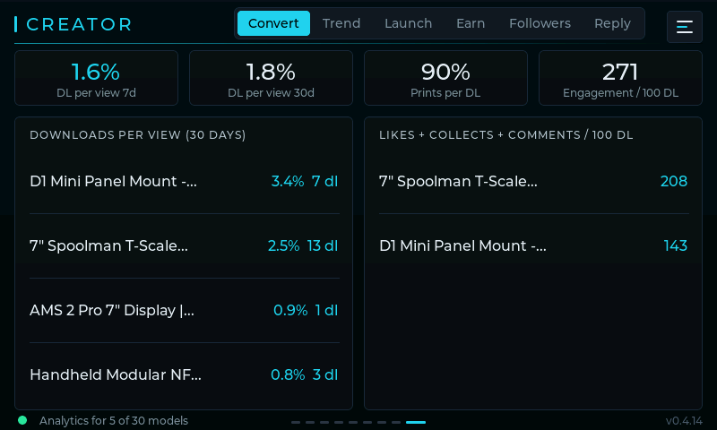 | 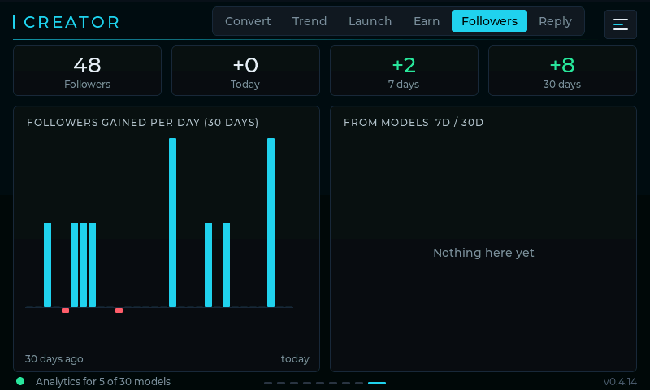 |
| Creator: conversion | Creator: followers |
| 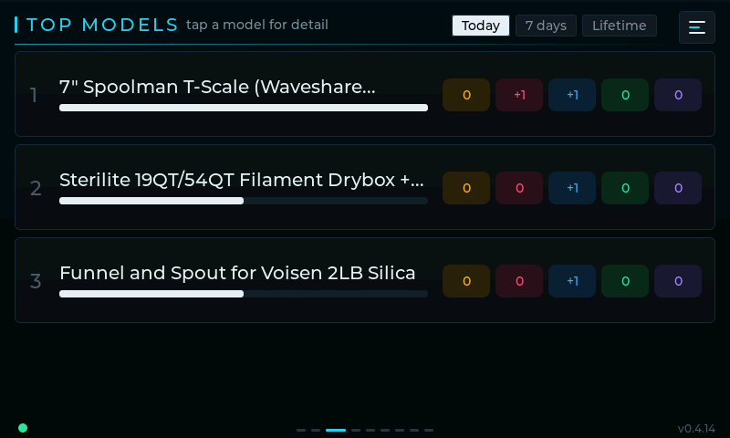 | 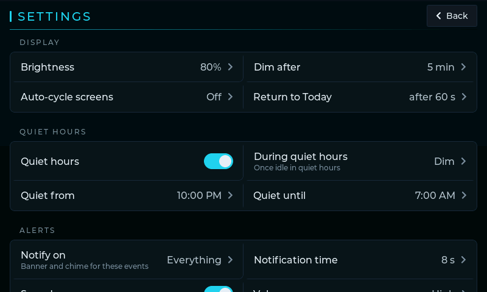 |
| Top models | On-screen settings |

The full set is in [`docs/screens/`](docs/screens/), captured from a running panel with `tools/capture_screens.sh`.

## Web dashboard

Built into the poller at `http://<poller-host>:8787/`. It works on a phone and follows your system's light or dark mode, and nothing needs installing.

<picture>
  <source media="(prefers-color-scheme: dark)" srcset="docs/screens/dashboard/overview-dark.png">
  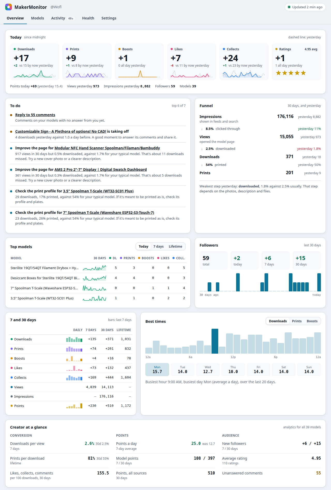
</picture>

- **Overview**: today's numbers against yesterday *by the same time of day*, with yesterday's hourly line underneath. A **To do** list tells you what to act on: comments to answer, a model taking off or spiking, a launch running slow, pages with plenty of views but few downloads, models downloaded but rarely printed. A **funnel** runs from impressions to views, downloads and prints and names the weakest step. Below that: top models, followers, 7 and 30-day totals and best times.
- **Models**: every model in one sortable, filterable table (downloads, views, downloads per view, prints, likes, collects, points, ratings, trend, unanswered comments), then creator insights: best converting, most engaging, pages to improve (with the downloads missed), print problems, rising, stalled, launch curve, **when to publish**, points and followers by model, best rated and the long tail.
- **Activity**: everything that happened today, with totals and a "needs a reply" list.
- **Health**: each MakerWorld data source, the cookie, the request budget and every panel.
- **Settings**: edit `config.yaml` (account, panels, notifications, quiet hours, polling). Changes are checked, backed up and applied without a restart.

| Models | Insights | Phone, dark |
|---|---|---|
| 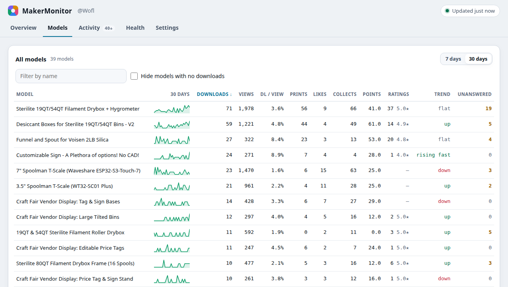 | 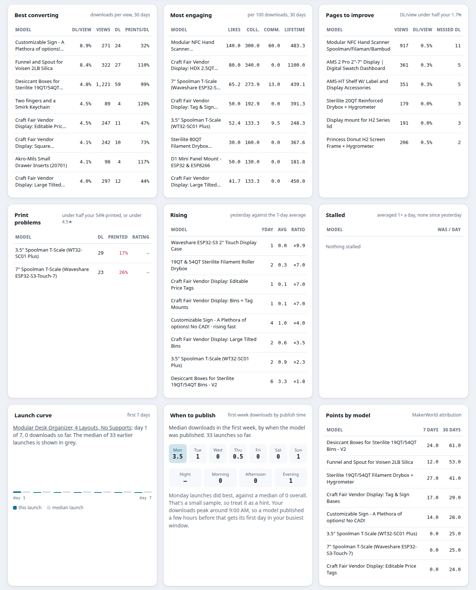 | 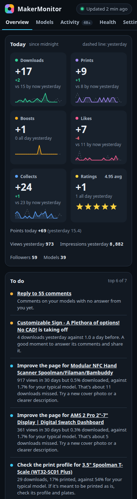 |

## Notifications

No hardware at all: get MakerWorld activity where you already are.

- **Eight channel types**: Discord, Telegram, Pushover, ntfy, Pushbullet, Home Assistant, Apprise (Slack, Matrix, Gotify and 100+ more) and a generic JSON webhook.
- **One tidy message per poll**, grouped by type, each with its own emoji and color: downloads, prints, boosts, likes, collects, ratings (with stars), comments (who and what), followers, points, and health alerts when the cookie expires or data goes stale.
- **An opt-in daily summary** at the time you pick: the day against yesterday, most downloaded models, any model that spiked, comments waiting for a reply, and the page most worth improving.
- **Per channel**: which events, quiet hours with a "while you were away" catch-up, urgent events that skip quiet hours, and minimum counts so small amounts wait.

Set it up in the dashboard's Settings tab (with a **Send test message** button) or in `config.yaml`. [`poller/NOTIFICATIONS.md`](poller/NOTIFICATIONS.md) covers every service and option.

## How it works

```
You browse makerworld.com now and then
        │
        ▼
Browser extension ──cookie──►  Poller (always on, port 8787)
                                  │
                                  ├──►  Desk panels     (color and e-paper, on your Wi-Fi)
                                  ├──►  Web dashboard   (any browser on your network)
                                  └──►  Notifications   (Discord, Telegram, Pushover, ntfy, ...)
```

The **poller** is the only part that has to keep running, on any always-on machine at home (Linux box, Raspberry Pi, NAS with Docker). It checks MakerWorld every 10 minutes by default, keeps history and pushes to everything else.

The **browser extension** keeps the poller logged in: when you visit MakerWorld, it hands your session cookie to the poller on your network. Without it you still get public counts; with it you also get points, views and impressions, and MakerWorld's per-model creator analytics.

More detail in [`docs/architecture.md`](docs/architecture.md).

## Quick setup

Start with the poller; add the dashboard, notifications and panels in any order.

### 1. Run the poller

Both options read the same `config.yaml`.

**Docker (compose)**

```bash
cd poller
mkdir -p docker-data
cp config.example.yaml docker-data/config.yaml   # set your handle and api_token
MM_UID=$(id -u) MM_GID=$(id -g) docker compose up -d --build
```

**Python (pip)**

```bash
cd poller
python3 -m venv .venv && source .venv/bin/activate
pip install -r requirements.txt
cp config.example.yaml config.yaml                 # set your handle and api_token
python -m makermonitor
```

The systemd unit, Docker details and the rest of the poller options are in [`poller/README.md`](poller/README.md).

### 2. Open the dashboard

Visit `http://<poller-host>:8787/?token=<api_token>` once. Your browser remembers it after that.

### 3. Install the browser extension

Load [`extension/`](extension/) as an unpacked extension in Chrome, Edge or Brave, set the poller URL (`http://<poller-host>:8787`) and the same `api_token`, then visit MakerWorld. Steps are in [`extension/README.md`](extension/README.md).

### 4. Add a panel

Plug in a [supported board](#supported-boards), open the **[web flasher](https://wolfrage76.github.io/MakerMonitor/)** in Chrome or Edge, pick the board and press **Connect and install**. Join it to your Wi-Fi on the screen. It then shows a **Connect the poller** page with its address; add that in the dashboard's Settings → Panels (or under `panels:` in `config.yaml`).

USB flashing, building from source, wireless updates and recovery are in [`firmware-color/README.md`](firmware-color/README.md#flash). The e-paper panel is in [`firmware-eink/README.md`](firmware-eink/README.md).

### 5. Add notifications

Add a channel in the dashboard's Settings → Notifications and press **Send test message**, or edit `notifications:` in `config.yaml` and run:

```bash
.venv/bin/python -m makermonitor --test-notify
```

## Supported boards

Every color board gets the same pages and features; only the layout changes to fit the screen.

| Board | Screen | Controls | Web flasher | PlatformIO env |
|---|---|---|---|---|
| Elecrow CrowPanel ESP32-S3 HMI 7.0" | 7", 800×480 | capacitive touch | ✅ | `crowpanel_70` |
| Waveshare ESP32-S3-Touch-LCD-7 | 7", 800×480 | capacitive touch | ✅ | `waveshare_70` |
| Guition JC4880P443C (ESP32-P4) | 4.3", 800×480 | capacitive touch | ✅ | `jc4880p443` |
| Guition JC3248W535 | 3.5", 480×320 | capacitive touch | ✅ | `jc3248w535` |
| Waveshare ESP32-S3-LCD-3.16 | 3.16", 820×320 | rotary knob (KY-040, [wiring](firmware-color/README.md)) | ✅ | `ws316` |
| Waveshare ESP32-S3-Touch-LCD-2 | 2", 320×240 | capacitive touch | ✅ | `ws_lcd2` |
| Elecrow CrowPanel ESP32-S3 HMI 5.0" | 5", 800×480 | capacitive touch | build it yourself | `crowpanel_50` |
| Elecrow CrowPanel ESP32-S3 HMI 4.3" | 4.3", 480×272 | resistive touch | build it yourself | `crowpanel_43` |

The CrowPanel 5" and 4.3" builds share the same code but haven't been tested on real hardware yet. The Elecrow CrowPanel 2.13" e-paper panel has its own firmware in [`firmware-eink/`](firmware-eink/); it is on hold, so it doesn't get the newer creator pages.

## Configuration

Everything lives in `poller/config.yaml`; start from the commented [`config.example.yaml`](poller/config.example.yaml). The essentials are your MakerWorld `handle` and an `api_token` you make up. Panels go in one `panels:` list of IPs or `.local` names, color and e-paper alike (the poller works out which is which). Everything else (panels, poll interval, notification channels, the daily summary) is optional.

Most of it can be changed from the dashboard's **Settings** tab, which checks your changes, keeps a backup of the previous file and applies them right away. Secrets can come from environment variables (`"${DISCORD_WEBHOOK}"`).

Panel settings (brightness, flip display, quiet hours, which events to show) are set on the panel itself or in its web console.

## Privacy and being polite to MakerWorld

- Your MakerWorld cookie only travels from your browser to the poller on your own network. Panels, the dashboard and notification services never see it.
- Notifications carry stats, model names and comment text, and only go to the services you set up.
- MakerWorld has no official creator API, so the poller is careful: one request at a time, a few seconds apart, about 120 an hour at most, with backoff when MakerWorld pushes back. The creator analytics fill in slowly in the background over a few hours.
- `config.yaml`, `poller/data/` (cookie and history) and private build settings are git-ignored.

## What's in the repo

| Path | What it is |
|---|---|
| [`poller/`](poller/) | The Python poller: MakerWorld fetching, the dashboard and Settings tab, notifications ([`NOTIFICATIONS.md`](poller/NOTIFICATIONS.md)), panel pushes |
| [`extension/`](extension/) | The browser extension that hands your MakerWorld cookie to the poller |
| [`firmware-color/`](firmware-color/) | Firmware for the color panels |
| [`firmware-eink/`](firmware-eink/) | Firmware for the CrowPanel 2.13" e-paper panel (on hold) |
| [`flasher/`](flasher/) | The [browser flasher](https://wolfrage76.github.io/MakerMonitor/) and how to rebuild and publish it |
| [`tools/`](tools/) | `capture_screens.sh` (screenshots every page of a running panel) and the flasher build and publish scripts |
| [`docs/`](docs/) | [`architecture.md`](docs/architecture.md) and the screenshots |

## FAQ and troubleshooting

**Do I need a panel?**
No. The poller with the dashboard, notifications, or both is a complete setup. A panel is the nicest way to see it.

**The dashboard says unauthorized.**
Open it once with `?token=<api_token>` from your `config.yaml`; the browser keeps a cookie for 180 days.

**Points and creator stats are missing.**
Those need the MakerWorld cookie. Check the extension's popup, then visit MakerWorld so it can send a fresh one. The dashboard's Health tab and the panel's Status page show the cookie's state.

**Where should the poller run?**
On an always-on machine on your home network. MakerWorld's Cloudflare check is often tied to your home IP, so a remote server tends to fail.

**The panel says "waiting for poller".**
Add the name or address from the panel's **Connect the poller** page (or its Status page) in the dashboard's Settings → Panels (takes effect right away), or under `panels:` in `config.yaml` and restart the poller. `.local` names keep working when your router hands out a new address.

**How often does it update?**
Every 10 minutes by default. The dashboard's Settings or a panel's Settings page can change that, and a panel's **Poll now** button asks for one right away.

**Something stopped working after MakerWorld changed its site.**
The data comes from MakerWorld's own (unofficial) web endpoints, which can change without notice. The dashboard's Health tab shows which source is failing.

## License

MIT, see [LICENSE](LICENSE).

Made by [@Wofl](https://makerworld.com/en/@Wofl), to stop refreshing a MakerWorld profile all day to see what was moving.
