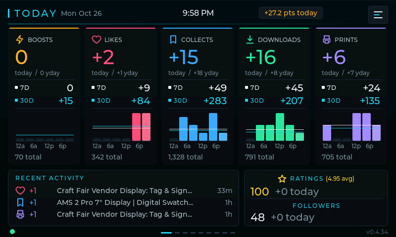
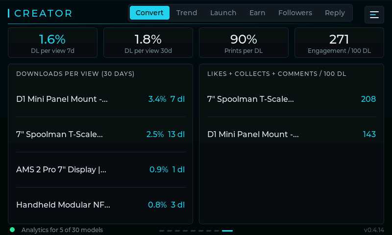
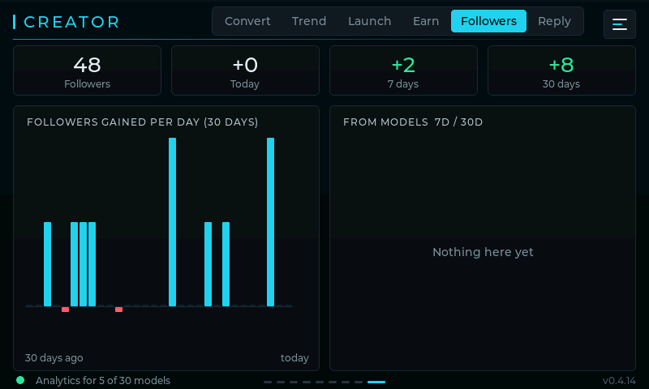
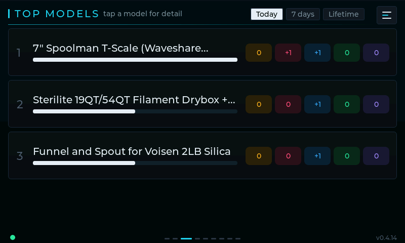
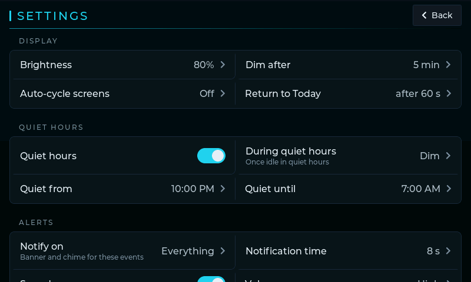

# MakerMonitor

**Your MakerWorld stats at a glance.** Downloads, prints, boosts, likes, collects, ratings, comments, followers and points, as they happen, without keeping a MakerWorld tab open all day.

I publish models on [MakerWorld](https://makerworld.com/en/@Wofl) and kept refreshing my profile to see what was moving. MakerMonitor does that for me: a small poller on my home network checks MakerWorld every few minutes and puts the numbers wherever I want them. On a phone, in Discord, or on a little touchscreen on my desk.



[](LICENSE)

## Pick your setup

The **poller** is the heart of it. Everything else is optional, so start small and add pieces when you want them.

| Setup | You need | You get |
|---|---|---|
| **1. Web dashboard** | The poller | A dashboard on your phone or desktop: today's numbers, 7/30-day totals, every model in a sortable table, creator insights, followers, best times, health, and a Settings tab |
| **2. Notifications** | The poller | Messages in Discord, Pushover, ntfy, Telegram, Home Assistant, Pushbullet, Apprise (Slack, Matrix, Gotify and 100+ more) or any webhook. No hardware at all |
| **3. Color panel** | The poller + an Elecrow CrowPanel 7", 5" or 4.3", a Waveshare ESP32-S3-Touch-LCD-7, ESP32-S3-Touch-LCD-2 or ESP32-S3-LCD-3.16 (rotary knob), or a Guition JC3248W535 3.5" | A desk display with live banners and chimes as things happen, swipeable pages and touch controls |
| **4. E-ink panel** | The poller + an Elecrow CrowPanel 2.13" e-paper | A low-power glanceable summary (this firmware is on hold, so it doesn't get the newer creator pages) |
| **5. Mix and match** | Any of the above | The dashboard is always there; add channels and panels side by side, several panels if you like |

```
You browse makerworld.com now and then
        │
        ▼
Browser extension ──cookie──►  Poller (always on, port 8787)
                                  │
                                  ├──►  Web dashboard   (any browser on your LAN)
                                  ├──►  Notifications   (Discord, Pushover, ntfy, Telegram, ...)
                                  ├──►  Color panels    (makermonitor.local)
                                  └──►  E-ink panel
```

The browser extension is how the poller stays logged in: when you visit MakerWorld, it hands your session cookie to the poller on your LAN. Without it you still get public counts; with it you also get points, the 30-day reach report and the creator analytics.

## Features

### 📊 Dashboard
- Opens at `http://<poller-host>:8787/` and works well on a phone. Light or dark follows your system, times are 12-hour.
- **Overview** with today's numbers, top models with sparklines, followers, 7/30-day totals and best times.
- **Models**: every model in one sortable table (downloads, views, downloads per view, prints, likes, collects, points, star ratings, trend, unanswered comments), with links to MakerWorld.
- **Activity**, **Health** (each data source, the cookie, the request budget) and a **Settings** tab that edits `config.yaml` and applies it without a restart.

### 🔔 Notifications
- Eight channel types, each with its own look: Discord, Pushbullet, Pushover, ntfy, Telegram, Home Assistant, Apprise and a generic JSON webhook.
- One message per poll, grouped by event type: downloads, prints, boosts, likes, collects, star ratings (with their stars), comments, followers, points, plus health alerts when the cookie expires or data goes stale.
- Per channel: which events, quiet hours, a "While you were away" digest when they end, and a minimum count before it bothers you.

### 🖥️ Panels
- **Color panels**: Today with 7/30-day context, a live feed, top models with per-model detail, trends, points, reach, comments, best times and creator pages. Banners (and on the 7", a chime) when something happens.
- Quiet hours with a night mode, a Settings page on the screen itself, on-screen Wi-Fi setup and a small web console at `http://makermonitor.local/` (the name is yours to change).
- Firmware updates over Wi-Fi; on the 7" panels the screen stays on with a progress bar.
- **E-ink panel**: today, 30 days, top models, best times, comments and account pages.

### 🧠 Creator insights
From MakerWorld's own per-model analytics (needs the cookie): downloads per view, prints per download, engagement per 100 downloads, rising and stalled models, your latest launch against your typical one, points per model, the long-tail share from older models, and comments you haven't replied to yet.

### 👥 Followers
Your follower count, today's gain, 7 and 30 days, and a bar per day for the last month, plus which models brought followers in. On the dashboard, the color panel and in notifications.

### 🕑 Best times
When your downloads, prints and boosts happen, by hour of day and by weekday, over the last 30 days. Handy for deciding when to publish.

## Quick start

### 1. Run the poller

Pick one. Both read the same `config.yaml`.

**Docker (compose)**

```bash
cd poller
mkdir -p docker-data
cp config.example.yaml docker-data/config.yaml   # set your handle and api_token
MM_UID=$(id -u) MM_GID=$(id -g) docker compose up -d --build
```

**Python (pip, optionally as a systemd service)**

```bash
cd poller
python3 -m venv .venv && source .venv/bin/activate
pip install -r requirements.txt
cp config.example.yaml config.yaml                 # set your handle and api_token
python -m makermonitor
```

[`poller/README.md`](poller/README.md) has the systemd unit, the Docker details and everything else.

### 2. Open the dashboard

Visit `http://<poller-host>:8787/?token=<api_token>` once. Your browser remembers it after that.

### 3. Install the browser extension

Load [`extension/`](extension/) as an unpacked extension in Chrome, Edge or Brave, set the poller URL (`http://<poller-host>:8787`) and the same `api_token`, then visit MakerWorld. Steps in [`extension/README.md`](extension/README.md).

### 4. Optional: notifications

Add channels under `notifications:` in `config.yaml` (or in the dashboard's Settings tab) and send a test:

```bash
.venv/bin/python -m makermonitor --test-notify
```

[`poller/NOTIFICATIONS.md`](poller/NOTIFICATIONS.md) covers every service and option.

### 5. Optional: a panel

The quickest way onto a CrowPanel 7", a Waveshare ESP32-S3-Touch-LCD-7, ESP32-S3-Touch-LCD-2 or ESP32-S3-LCD-3.16, or a Guition JC3248W535 3.5" is the **[web flasher](https://wolfrage76.github.io/MakerMonitor/)**: plug the panel in over USB, open the page in Chrome or Edge, pick the board and press **Connect and install**.

Or build and flash it with PlatformIO:

```bash
cd firmware-color
rm -f sdkconfig.defaults
pio run -e crowpanel_70 -t upload      # or waveshare_70, ws_lcd2, ws316, jc3248w535, crowpanel_50, crowpanel_43
```

Join it to your Wi-Fi on the screen. Until the poller knows about it, the panel shows a **Connect the poller** page with the line to add to `config.yaml` (`panels: ["makermonitor.local"]`), or add it in the dashboard's Settings tab. Build notes, controls and the full feature list are in [`firmware-color/README.md`](firmware-color/README.md); the e-ink panel is in [`firmware-eink/README.md`](firmware-eink/README.md).

## Configuration

Everything lives in `poller/config.yaml`; start from the commented [`config.example.yaml`](poller/config.example.yaml). The essentials are your MakerWorld `handle` and an `api_token` you make up. Panels go in one `panels:` list of IPs or `.local` names, color and e-paper alike (the poller works out which is which). The panel list, the poll interval (10 minutes by default) and notification channels are all optional.

Most of it can also be changed from the dashboard's **Settings** tab, which checks your changes before saving, keeps a backup of the previous file and applies them right away. Secrets can come from environment variables (`"${DISCORD_WEBHOOK}"`).

Panel settings (brightness, quiet hours, which events to show, the poll interval) are set on the panel itself or in its web console.

## Privacy and being polite to MakerWorld

- Your MakerWorld cookie only travels from your browser to the poller on your own network. Panels, the dashboard and notification services never see it.
- Notifications carry stats, model names and comment text, and only go to the services you set up.
- MakerWorld has no official creator API, so the poller is careful: one request at a time, a few seconds apart, about 120 an hour at most, with backoff when MakerWorld pushes back. The creator analytics fill in slowly in the background over a few hours.
- `config.yaml`, `poller/data/` (cookie and history) and private build settings are git-ignored.

## Screenshots

From the 7" color panel (captured with `tools/capture_screens.sh`; the full set is in [`docs/screens/`](docs/screens/)):

| | | |
|---|---|---|
|  |  |
| Creator: Convert | Creator: Followers |
|  |  |
| Top models | Settings |

## What's in the repo

| Path | What it is |
|---|---|
| [`poller/`](poller/) | The Python poller: MakerWorld fetching, the dashboard and Settings tab, notifications, panel pushes. See also [`NOTIFICATIONS.md`](poller/NOTIFICATIONS.md) |
| [`extension/`](extension/) | The browser extension that hands your MakerWorld cookie to the poller |
| [`firmware-color/`](firmware-color/) | Firmware for the color panels (CrowPanel 7" / 5" / 4.3", Waveshare ESP32-S3-Touch-LCD-7 and -LCD-2, Waveshare ESP32-S3-LCD-3.16, Guition JC3248W535 3.5") |
| [`firmware-eink/`](firmware-eink/) | Firmware for the CrowPanel 2.13" e-paper panel (on hold) |
| [`flasher/`](flasher/) | The [browser flasher](https://wolfrage76.github.io/MakerMonitor/) and how to rebuild and publish it |
| [`tools/`](tools/) | `capture_screens.sh`, which screenshots every page of a running color panel, and the flasher build and publish scripts |
| [`docs/`](docs/) | [`architecture.md`](docs/architecture.md) (how the pieces fit, request limits, updates) and the screenshots |

## FAQ and troubleshooting

**Do I need a panel?**
No. The poller with the dashboard, notifications, or both is a complete setup.

**The dashboard says unauthorized.**
Open it once with `?token=<api_token>` from your `config.yaml`; the browser keeps a cookie for 180 days.

**Points and creator stats are missing.**
Those need the MakerWorld cookie. Check the extension's popup, then visit MakerWorld so it can send a fresh one. The dashboard's Health view and the panel's Status page show the cookie's state.

**Where should the poller run?**
On an always-on machine on your home network (a Linux box, a Raspberry Pi, a NAS with Docker). MakerWorld's Cloudflare check is often tied to your home IP, so a remote server tends to fail.

**The color panel says "waiting for poller".**
Add the name or address from the panel's **Connect the poller** page (or its Status page) to the panel list: in the dashboard's Settings tab (takes effect right away), or under `panels:` in `config.yaml` and restart the poller. `.local` names keep working when your router hands out a new address.

**How often does it update?**
Every 10 minutes by default. The panel's Settings or the dashboard can change that, and a panel's Poll now button asks for one right away.

**Something stopped working after MakerWorld changed its site.**
The data comes from MakerWorld's own (unofficial) web endpoints, which can change without notice. The Health view shows which source is failing.

## License

MIT, see [LICENSE](LICENSE).
