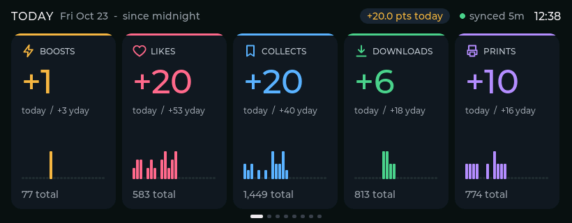

# MakerMonitor Color

Color stats panel firmware. It shows today's new Boosts, Likes, Collects, Downloads and Prints, and pops a banner as each one (or a new comment) arrives.

| Board | Screen | Controls | Env |
|---|---|---|---|
| Waveshare ESP32-S3-LCD-3.16 | 820×320 | KY-040 knob | `ws316` |
| Elecrow CrowPanel ESP32-S3 HMI 4.3" | 480×272 | resistive touch | `crowpanel_43` |
| Elecrow CrowPanel ESP32-S3 HMI 5.0" | 800×480 | capacitive touch | `crowpanel_50` |
| Elecrow CrowPanel ESP32-S3 HMI 7.0" | 800×480 | capacitive touch | `crowpanel_70` |

Each board has a header in `include/boards/` (pins, timings, controls). Boards with a touchscreen use touch; boards without one use the knob. The layout adapts to the screen: 800×480 gets taller cards, 480×272 smaller type and fewer columns. The 7" CrowPanel is the panel this firmware is tested on. The 4.3" and 5" builds use the same code with their own pin headers.

It is a thin client: the existing Python poller does all MakerWorld work and pushes stats to it. The e-ink panel keeps working alongside.



## Wiring the knob (Waveshare 3.16")

| KY-040 | Board |
|---|---|
| CLK | GPIO 43 (UART header TX) |
| DT | GPIO 44 (UART header RX) |
| SW | GPIO 0 (BOOT button pad) |
| + | 3.3 V |
| GND | GND |

Serial logs go over USB, so the UART header pins are free. Holding the knob while plugging in puts the board in flash mode (same as BOOT). Optional: a 1 kΩ resistor in series on CLK protects GPIO 43, which the boot ROM briefly drives.

## Flash

1. Install PlatformIO (VS Code extension or `pip install platformio`).
2. `cd firmware-color && pio run -e <env> -t upload` over USB-C (env from the table above).
3. First boot opens a Wi-Fi setup hotspot (**MakerMonitor-Color**, or **MakerMonitor-CP43 / CP50 / CP70** on the CrowPanels). Join it and pick your network.
4. The Today screen header shows the panel's IP.

The panel hostname is `makermonitor-` plus the last five hex digits of its MAC, for example `makermonitor-e3b7d.local`. It is on the Status screen. Wi-Fi uploads use the `<env>_ota` environments; set `upload_port` in gitignored `platformio_override.ini` to that hostname or the panel IP. There is no firmware password in the repo. The panel's web console can set one; leave it blank for LAN uploads.

Open `http://<panel-ip>/` for the console (status, display settings, local `.bin` upload, and GitHub release checks). GitHub installs look for `wolfrage76/MakerMonitor` release assets named in each board header (`firmware-crowpanel-70.bin`, and the matching names for the other boards).

## Point the poller at it

In `poller/config.yaml` add:

```yaml
color_panel_host: "192.168.1.xxx"   # IP from the panel
color_panel_port: 80
```

Several panels: separate them with commas, e.g. `color_panel_host: "192.168.1.50, makermonitor-e3b7d.local"`. Every panel gets the same stats; the poll interval follows whichever panel's setting changed last.

Restart the poller (`sudo systemctl restart makermonitor-poller`). Within one poll the panel fills in. The e-ink settings (`panel_host`) stay as they are.

## Controls

| Knob | Touch | Action |
|---|---|---|
| Turn | Swipe left / right | Next / previous screen. With a banner up: next banner. |
| Press | Tap | Screen action: Feed filter, Top models Today/7 days/Lifetime, Trend stat, next Comments, Status "poll now". With a banner up: clear. |
| Hold 1 s | Long press | Settings menu. Knob: turn to move, press to change, hold or Exit to leave. Touch: tap a setting to change it, tap Exit to leave. |

Settings (saved on the panel): brightness, auto-cycle, which events notify, quiet hours (no banners, screen dims), **poll interval** (the poller reads it within 15 s), return-to-Today delay, banner time.

## Screens

Today, Live feed, Top models, 7-day trend, Points, Reach (30 days), Comments, Status. Previews of the real UI are in [`docs/`](docs/).

## How "today" works

MakerWorld only gives lifetime totals. At the first poll of each day the poller keeps the last pre-midnight snapshot as the baseline; today = now − baseline. If the poller wasn't running at midnight, the header says "since HH:MM" instead of "since midnight". The poller stores this in `poller/data/daily.json` (30 days of history), so reboots of either side lose nothing.

## If something looks wrong

All of these are one-line changes in the board's header in `include/boards/` (`ws316.h` for the Waveshare):

- **Upside down:** `LCD_ROTATION` → `LV_DISP_ROT_270`.
- **Blank or garbled screen:** the ST7701 init table in `src/display.cpp` came from a working ESPHome config for this board. Compare it with Waveshare's `07_LVGL` demo and swap it in if they differ. Also try `LCD_PCLK_NEG 1`.
- **One click moves two screens:** `KNOB_STEPS_PER_DETENT 2`. **Backwards:** `KNOB_REVERSE 1`.
- **Backlight inverted:** `LCD_BL_ACTIVE_HIGH 0`.
- **CrowPanel picture drifts or flickers:** lower `LCD_PCLK_HZ` (e.g. 12 or 8 MHz).
- **Touch lands in the wrong place:** set `TOUCH_FLIP_X`, `TOUCH_FLIP_Y` or `TOUCH_SWAP_XY` to 1. On the 4.3", adjust `TOUCH_RAW_X0/X1/Y0/Y1`.
- **CrowPanel touch dead:** the serial log prints `GT911 found/not found`. Board v3 needs the PCA9557 release in `src/touch.cpp`, which runs automatically when the chip isn't found.

## Speaker

The 7" CrowPanel has an NS4168 I2S speaker, used for event chimes. The other boards in this tree do not.

## Files

| File | What |
|---|---|
| `include/boards/*.h` | Per-board pins, timings and controls |
| `src/display.cpp` | RGB panel + LVGL driver (ST7701 init and rotation for the Waveshare) |
| `src/touch.cpp` | GT911 / XPT2046 touch as an LVGL pointer |
| `src/knob.cpp` | Encoder + button (short / long press) |
| `src/model.cpp` | JSON → `State` / `Event` |
| `src/ui.cpp` | All screens, banner, settings menu; layout adapts to the screen size |
| `src/settings.cpp` | Menu options, saved in NVS |
| `src/main.cpp` | Wi-Fi, HTTP API, OTA, state cache |
| `src/icons.c` | Stat icons (made by `tools/gen_icons.py`) |

HTTP API: `GET /` (web console), `POST /v2/state`, `POST /v2/event`, `GET /v2/settings`, `GET /ping`, `POST /update` (local firmware upload).
